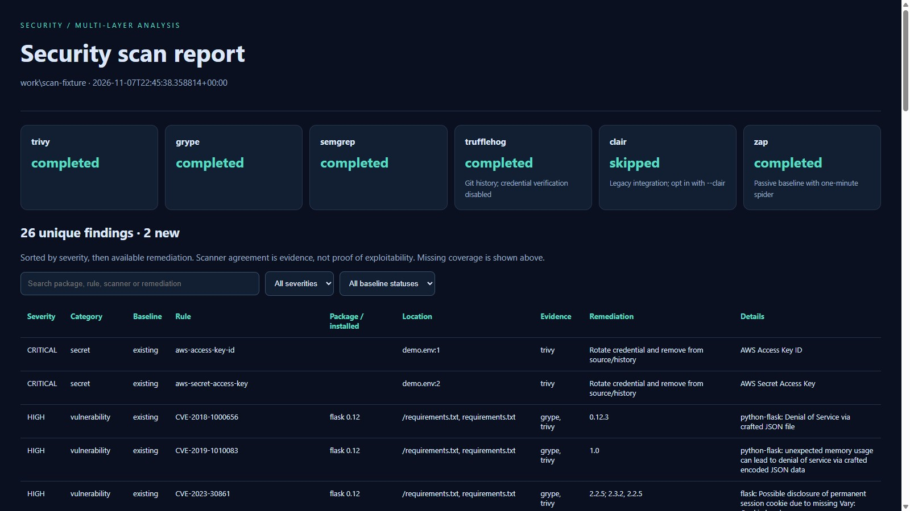

# SecurityScan-Suite




*Example report from a test fixture.*

One command runs Docker-based dependency, code, secret-history, configuration, and license analysis. An optional web target adds OWASP ZAP. Reports combine scanner evidence, prioritize remediation, and compare against previous scans.

**Requirements:** Python 3.9+, a running Linux Docker engine, network access for vulnerability databases/rules, and Git for remote repository targets. No Python packages are required. Source is mounted read-only. Official scanner images are pinned by digest in `scanner_images.py`; Trivy and Grype databases use persistent Docker cache volumes.

## Quick start

```powershell
# Windows: current project or another directory
.\run_all.bat
.\run_all.bat C:\path\to\project --no-browser
```

```bash
# Linux / macOS
./run_all.sh /path/to/project --no-browser
python3 scan_docker.py https://github.com/your-org/your-repo --no-browser
python3 scan_docker.py nginx:latest --no-browser
```

Both launchers resolve the script relative to themselves and forward arguments. Targets and output paths remain relative to the caller. A Git URL is cloned once with history, then the source scanners inspect that checkout. Authentication uses the host Git setup; credentials are not injected into scanner containers.

## Scan coverage

| Layer | Tool | Directory / Git | Registry image | Extra configuration |
| --- | --- | --- | --- | --- |
| Dependency vulnerabilities | Trivy + Grype | Yes | Yes | Databases download automatically |
| Code patterns | Semgrep | Yes | Skipped | Default `p/security-audit` rules; configurable |
| Secrets in current files | Trivy | Yes | Yes | Default enabled |
| Git-history secrets | TruffleHog | Yes, when `.git` exists | Skipped | Filesystem fallback without `.git` |
| Configuration | Trivy | Yes | Supported image configuration | Default enabled |
| Licenses | Trivy | Yes | Yes | Default enabled |
| Running web application | ZAP | Separate `--url` | Separate `--url` | Explicit URL required |
| Legacy image analysis | Clair | Unsupported | Opt-in | Compatible server required |

License coverage depends on available metadata: a bare Python requirements file may identify versions without supplying package licenses. Full license-file detection is enabled, and recognizable license documents are reported.

Secret verification is disabled in TruffleHog: discovery does not attempt authentication with found credentials. Semgrep uses its registry for default rules but runs code analysis in the local container with metrics disabled. Supply a local YAML via `--semgrep-config` to choose your rules. `--skip-semgrep` and `--skip-trufflehog` disable those layers explicitly, with skips shown in the report.

Registry images must be accessible from inside scanner containers. Local-only images, private-registry credential injection, Git submodule initialization, and authenticated web journeys are not automatically configured.

## Web scanning

```bash
# Passive analysis with a one-minute spider; this makes HTTP requests to the site.
python scan_docker.py . --url https://your-staging-app.example --no-browser

# Explicit active testing for a staging target you control
python scan_docker.py . --url https://your-staging-app.example --zap-active --no-browser

# A web server on your Docker Desktop host
python scan_docker.py . --url http://host.docker.internal:8080 --no-browser
```

ZAP defaults to baseline scanning, which crawls the supplied site and passively analyzes traffic. `--zap-active` switches to the full active scanner and can modify application state; use a disposable staging environment. No URLs are inferred from source or automatically tested by CI. Linux hosts may need their own reachable hostname or Docker networking configuration.

## Reports

Each run writes `combined_report_TIMESTAMP.html`, `.json`, and `.sarif` to `results/` (change with `--output`).

- HTML supports text search, severity and baseline filters, every finding, installed versions, remediation, scanner status, and source locations.
- Deduplication merges identical rule/package/version/ecosystem identities and retains scanner names and discovered locations. It conservatively preserves different advisory identifiers and ecosystems. A single CVE alias supplied by Grype is used to combine its GHSA result with Trivy, retaining original advisory IDs. Ambiguous or missing aliases remain separate.
- Findings sort by severity, then available remediation. Agreement between tools does not prove exploitability. License results indicate obligations to review, not necessarily a vulnerability.
- JSON includes stable fingerprints, coverage status, baseline status and policy outcome. SARIF can be imported into compatible code-scanning systems.
- Missing, partial, and failed scanner results are distinguished from completed scans. Timeouts fail the run; the named container is removed.

Combined exports and Semgrep/TruffleHog output files omit raw secret values and source snippets. **Original Trivy JSON and ZAP output can contain sensitive data.** Keep raw artifacts private. CI uploads only combined reports, whose file paths and finding metadata may still be sensitive in private projects.

## Baselines and CI policy

```bash
# Initial report
python scan_docker.py . --no-browser --output results

# Compare to a saved combined JSON report from the same target
python scan_docker.py . --baseline previous-report.json --fail-on HIGH --only-new --no-browser

# Apply policy only to findings with reported remediation
python scan_docker.py . --fail-on HIGH --only-fixable --no-browser
```

Without a baseline, findings are `uncompared`. With a baseline they are `new` or `existing`; absent fingerprints are counted separately in JSON. Absence is not proof of resolution if coverage changed or a scanner failed. Package-version changes intentionally produce new fingerprints. Secret fingerprints incorporate a one-way content hash so a different credential at the same location is treated as new. `--only-new` requires a baseline with the same target string. `--only-fixable` means remediation text is present, not that an upgrade is guaranteed safe.

Exit codes: **0** = completed and policy passed, **1** = severity policy failed, **2** = configuration/scanner failure or incomplete required analysis. The default policy is `--fail-on NONE`. Scanner failures take precedence over finding gates. `--timeout` controls the per-process limit (default 900 seconds).

The `Security scans` GitHub Actions workflow runs on pull requests, main pushes, weekly, and manually. It checks code, dependencies, licenses and full Git history. Successful default-branch runs save a baseline; later scans fail on **new High/Critical** findings. The first scan establishes a baseline without a severity gate. Cache eviction can cause a fresh baseline; scanner execution failures still fail. Pull requests never save the trusted default-branch baseline. Reports are retained for 14 days. Unit regression CI runs on Windows/Linux and Python 3.9/3.14.

## Legacy entry points

`scan_docker.py` is the main CLI. `security_scan.py` exposes the same expanded workflow. `scan_all.py` remains the older local-binary runner with shared HTML escaping; it does not have the new multi-layer orchestration or CI policy. The old `test_with_mock_data.py` demonstrates legacy report rendering.

`--clair` and `docker-compose.yml` remain a legacy third-party integration, disabled by default and not migrated to modern Clair v4. A compatible server is required. This update does not claim verified Clair coverage.

## Validation and maintenance

```bash
python -m unittest discover -p 'test_*.py' -v
python -m compileall -q scan_docker.py security_scan.py findings.py reporting.py
```

Update image digests deliberately in `scanner_images.py`, then rerun the tests and a live integration scan. Image pinning stabilizes tooling; vulnerability databases and remote Semgrep rules continue updating. Disk caches use Docker volumes `security-trivy-cache` and `security-grype-cache`.

Documentation: [Trivy](https://trivy.dev/) · [Grype](https://oss.anchore.com/docs/) · [Semgrep](https://semgrep.dev/docs/) · [TruffleHog](https://github.com/trufflesecurity/trufflehog) · [ZAP](https://www.zaproxy.org/docs/docker/baseline-scan/)

## License

See [LICENSE](LICENSE).
